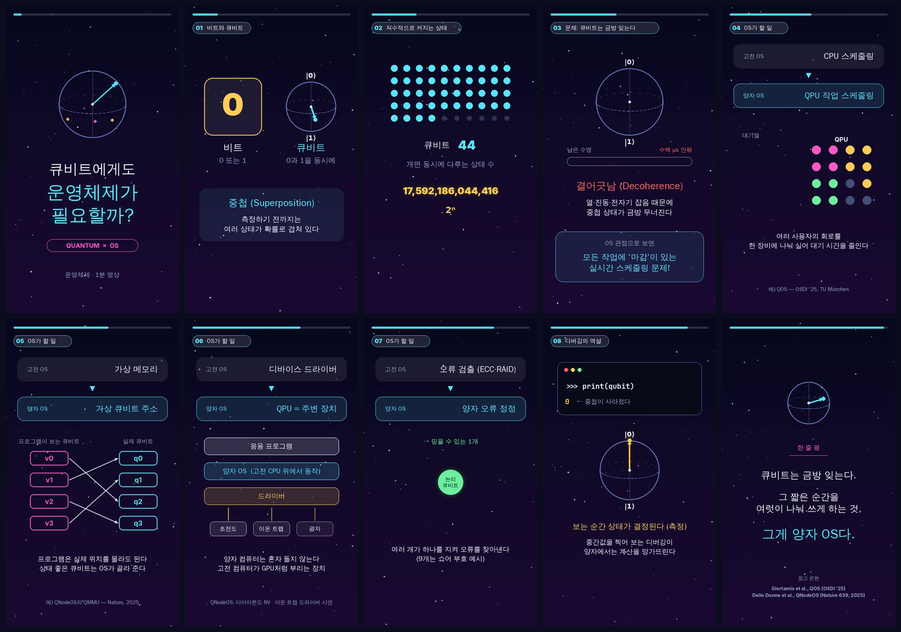

# 운영체제 레포트 — 양자 컴퓨터 1분 영상

**제목:** 「큐비트에게도 운영체제가 필요할까?」  
**제출자:** 학번 __________ · 이름 __________  
**형식:** 60초 · 9:16 · 360×640 · 30fps · H.264/AAC (`quantum_os_shorts.mp4`)

---

## 1. 기획 의도

양자 컴퓨터 소개 영상은 대개 "0과 1을 동시에"에서 끝난다. 이 영상은 운영체제 수업의
관점에서 질문을 하나 더 던진다. **"양자 컴퓨터를 여러 사람이 나눠 쓰려면 무엇이 필요한가?"**

답은 우리가 배운 OS 개념이 그대로 다시 등장한다는 것이다. 다만 양자에서는 조건이 훨씬
가혹하다.

| 고전 OS 개념 | 양자 컴퓨터에서의 모습 | 왜 더 어려운가 |
|---|---|---|
| CPU 스케줄링 | 여러 사용자의 회로를 한 QPU에 나눠 싣기 | 큐비트가 수백 μs 안에 상태를 잃으므로 **모든 작업에 마감이 있다**(실시간 스케줄링) |
| 가상 메모리 | 가상 큐비트 주소 → 실제 큐비트 매핑 | 큐비트마다 품질(오류율)이 달라 **"좋은 자리"를 골라 줘야** 한다 |
| 디바이스 드라이버 | QPU를 GPU처럼 부리는 주변 장치로 다룸 | 초전도·이온 트랩·광자 등 **물리 방식이 제각각** |
| 오류 검출(ECC·RAID) | 양자 오류 정정(물리 큐비트 여러 개 → 논리 큐비트 1개) | 값을 복사할 수 없어(복제 불가 정리) **단순 중복이 안 된다** |
| 디버깅(printf) | 측정하면 상태가 붕괴 | **들여다보는 행위가 계산을 망친다** |

## 2. 콘티 (시간 배분은 과제 조건을 따름)

| 시간 | 장면 | 화면 | 핵심 메시지 |
|---|---|---|---|
| 0–5초 | **타이틀** | 회전하는 블로흐 구, 네온 제목 | 큐비트에게도 운영체제가 필요할까? |
| 5–13초 | 01 비트와 큐비트 | 깜빡이는 0/1 상자 vs 블로흐 구 | 중첩: 측정 전에는 여러 상태가 겹쳐 있다 |
| 13–20초 | 02 지수적 상태 | 큐비트 점이 50개까지 켜지며 2ⁿ 카운터 | 50개면 약 1,126조(2⁵⁰) 개의 상태 |
| 20–28초 | 03 결어긋남 | 상태 벡터가 떨리며 사라지고 수명 막대가 줄어듦 | 마감이 있는 실시간 스케줄링 문제 |
| 28–33초 | 04 스케줄링 | 대기열의 회로 A·B·C가 QPU 격자로 날아감 | 한 장비를 나눠 써서 대기 시간 감소 (QOS) |
| 33–38초 | 05 가상 큐비트 | v0–v3 → q0–q3 매핑 화살표 | 프로그램은 실제 위치를 몰라도 된다 (QNodeOS의 QMMU) |
| 38–43초 | 06 드라이버 | 응용 / 양자 OS / 드라이버 계층 + 하드웨어 3종 | QPU는 고전 컴퓨터가 부리는 장치 |
| 43–48초 | 07 오류 정정 | 9개 점(일부 빨간 오류)이 초록 논리 큐비트 1개로 합쳐짐 | 여럿이 하나를 지킨다 (쇼어 9큐비트 부호) |
| 48–55초 | 08 디버깅의 역설 | `print(qubit)` 입력 → 섬광 → 벡터가 \|0⟩로 붕괴 | 보는 순간 결정된다 → 실행 전 검증이 필요 |
| 55–60초 | **한줄 평** | 문장이 한 줄씩 나타남 + 참고 문헌 | 아래 참고 |

> **한줄 평 —** 큐비트는 금방 잊는다. 그 짧은 순간을 여럿이 나눠 쓰게 하는 것, 그게 양자 OS다.

## 3. 제작 방법 (완성도를 위해 한 것)

- **영상 전체를 코드로 생성**: Python(Pillow·NumPy)으로 1,800프레임을 직접 그리고 ffmpeg으로
  인코딩했다(`make_video.py`). 장면마다 "시각 t를 받아 그 순간을 그리는 함수"를 두어
  타이밍을 숫자로 정확히 맞췄다. 0–5초 타이틀, 55–60초 한줄 평은 프레임 단위로 지켜진다.
- **슈퍼샘플링**: 720×1280으로 그린 뒤 360×640으로 줄여, 저해상도에서도 원과 선이 매끄럽다.
- **배경음·효과음 직접 합성**: Am–F–C–G 화음 패드와 아르페지오, 장면 전환음, 측정 순간의
  "틱" 소리를 사인파와 노이즈로 만들었다. **외부 음원을 쓰지 않아 저작권 문제가 없다.**
- **AI 애니메이션 확장판 준비**: 마스코트 「큐비」를 주인공으로 한 영상 AI용 장면별 프롬프트(`docs/prompts.md`)와,
  장면 길이에 맞춰 음절 수를 계산한 내레이션 대본(`docs/narration.md`, 1초당 5음절 이내)을 만들었다. 영상 AI는 한글을
  깨뜨리므로 클립에는 글자를 넣지 않고, 합성기(`compose.py`)가 자막·타이틀·한줄 평·음악을 덧입혀 시간 배분을 지킨다.
  내레이션은 무음을 잘라 장면 시작 0.3초 뒤에 맞추고, 말하는 동안 배경음악을 30%로 줄인다(더킹).
  *AI 클립·음성을 넣어 완성하면 사용한 툴 이름과 출처를 이 칸에 적는다.*
- **검수**: 장면별 대표 프레임과, 인코딩된 MP4에서 다시 뽑은 프레임 16장을 눈으로 확인했다
  (그 과정에서 영문 폰트로 찍힌 한글이 □로 깨지는 결함을 찾아 고쳤다).

## 4. 사실 확인

- 초전도 큐비트의 결맞음 시간은 장비에 따라 대략 수십~수백 μs 범위다. 그래서 영상에는
  특정 수치 대신 **"수백 μs 안팎"**으로 적었다.
- 2⁵⁰ = 1,125,899,906,842,624 ≈ 1,126조.
- 9큐비트는 쇼어 부호(Shor code)의 예시다. 실제 장비는 표면 부호 등 다른 방식도 쓴다.

## 5. 참고 문헌

1. E. Giortamis, F. Romão, N. Tornow, P. Bhatotia, **"QOS: A Quantum Operating System,"**
   *USENIX OSDI '25*, pp. 429–447, 2025. <https://www.usenix.org/conference/osdi25/presentation/giortamis>
   (arXiv:2406.19120) — 양자 자원을 위한 클라우드 OS. 여러 회로를 한 장비에 함께 싣는
   다중 프로그래밍과 스케줄링으로 활용도를 최대 9.6배 높이고 대기 시간을 최대 5배 줄였다고 보고.
2. C. Delle Donne et al., **"An operating system for executing applications on quantum network nodes,"**
   *Nature* 639, 2025. <https://pmc.ncbi.nlm.nih.gov/articles/PMC11903313> — QNodeOS.
   가상 큐비트 주소를 관리하는 QMMU, 다이아몬드 NV 및 이온 트랩 노드용 드라이버를 시연.
